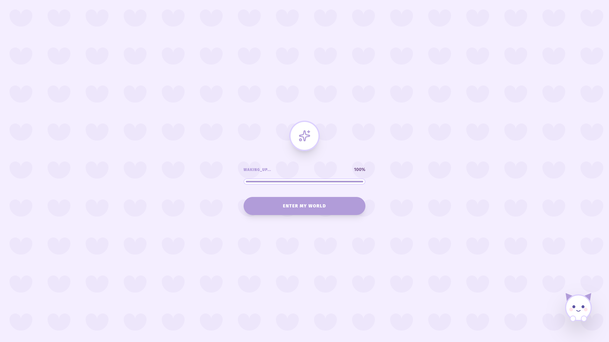
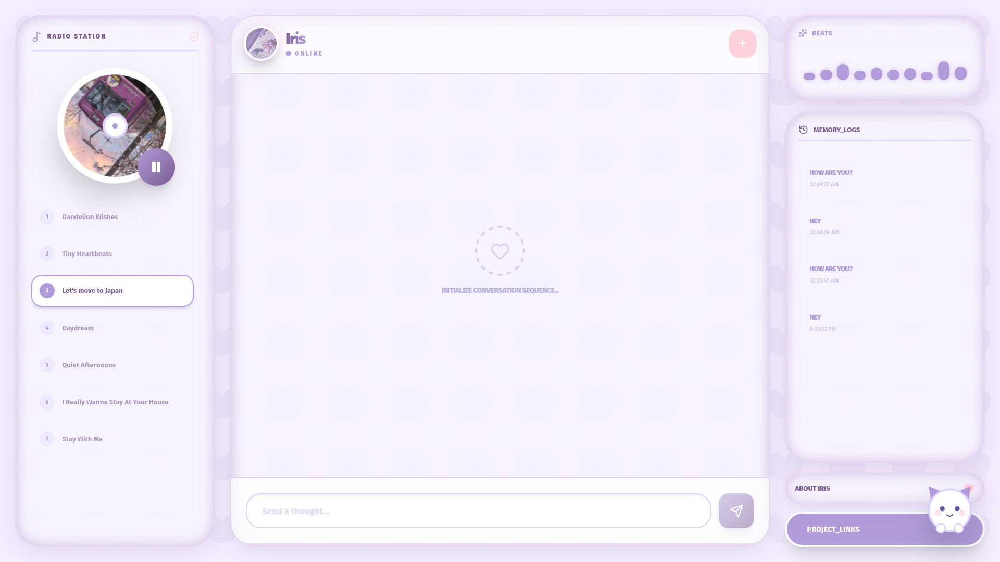

# IRIS

[](https://nextjs.org/)
[](https://huggingface.co/meta-llama/Meta-Llama-3-8B)
[](https://huggingface.co/spaces/lilLilith/Iris-RAG/tree/main)
[](https://tailwindcss.com/)


I made Iris. I took 12k+ real WhatsApp messages from my friend "Senpai" and baked her whole personality into a Llama-3 8B model. She says "Kk" instead of okay, rolls her eyes at you , calls you baka, and answers your questions. And now she can even look things up on the web when you ask about something recent

[Try Iris live](https://iris-chat-bot-lac.vercel.app/) · [Kaggle notebook](https://www.kaggle.com/code/hamnamubarak/iris-model/edit) · [Hugging Face Space](https://huggingface.co/spaces/lilLilith/Iris-RAG/tree/main) · [Dev log](DEVLOG.md)

---


When you open Iris, she takes a second to wake up first:



And then you're in, there will be music on the left, chat in the middle, your old chatz saved on the right:




## How I made her

### 1. Cleaning the chats
I started with a WhatsApp exporrt of about **81,000 lines**, full of timestamps, "media omitted" and random stickers. After cleaning it up, I turned it into **12,613 dialogue samples**. Senpai sends a bunch of short messages in a row instead of one long one, so I grouped consecutive messages together to keep that natural texting feel.

### 2. Training
I fine tuned the model on Kaggle using **Unsloth**, which makes training big models way lighter on memoryy

- **Base model:** Llama-3 8B
- **Learning rate:** `5e-5`
- **Steps:** `1000`
- **Sequence length:** `2048`
- **Hardware:** Kaggle T4 x2 GPUs

The loss went from around **2.5 down to 0.3**, and the first time she replied with "Kk " I knew it worked

### 3. Exporting
After training I exported the model to **GGUF (Q4_K_M)** and also uploaded the merged model to Hugging Face, which is what the Space runs today

---

## How a message is transformed before processing

When you send Iris a message, this is what happens :

1. **The router reads it first.** A small model on Hack Club AI rewrites your message so it makes sense on its own, decides if it needs a web search, and notes things about you worth remembering (like your name)
2. **Web search, only if needed.** For recent stuff, it searches the web with Exa and grabs the facts
3. **Senpai replies.** Your message, the chat history, what she remembers about you, and any facts all go to the model running on a **Hugging Face ZeroGPU** Space, and she answers in her own style


## Run it yourself

1. **Clone the repo**
   ```bash
   git clone https://github.com/lilithCode/Iris_ChatBot.git
   cd Iris_ChatBot
   ```

2. **Install everythiing**
   ```bash
   npm install
   ```

3. **Add a `.env` file** in the root folder with these:
   ```
   AMADEUS_SPACE_URL=   # your Hugging Face ZeroGPU Space URL
   HF_TOKEN=            # your Hugging Face token
   HACKCLUB_AI_KEY=     # your Hack Club AI key (for the router and web search)
   ```
   If you skip `HACKCLUB_AI_KEY`, Iris still works, she just won't search the web.

4. **Start it**
   ```bash
   npm run dev
   ```
   Then open [http://localhost:3000](http://localhost:3000) and say hi to Senpai.

For a production build:
```bash
npm run build
npm run start
```

---

## Contributing

Ideas, fixes and PRs are always welcome, Just keep changes focused. If you're changing anything about the model or training, please add the steps you used so I can understnad better :)
